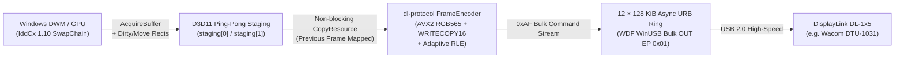

# oxidisplay

An unofficial, clean-room, **zero-dependency pure Rust** Windows Indirect Display Driver (**UMDF 2.33 + IddCx 1.10**) for **DisplayLink DL-1x5 (USB 2.0)** displays.

DisplayLink DL-1x5（USB 2.0）チップセット搭載ディスプレイ向けに、**外部クレート依存ゼロの純Rust**で一から実装した非公式 Windows 間接ディスプレイドライバ（**UMDF 2.33 + IddCx 1.10**）です。

Tested on **Wacom DTU-1031** (`USB\VID_17E9&PID_04A3`, 1280×800 @ 60 Hz) on Windows 11 (x64).

---

## Highlights / 主な特徴

- **Locked 60 FPS on USB 2.0**: Achieves **59.6–60.2 FPS** (`p50 = 16.6 ms`) across idle, UI scroll, video, and full-screen motion workloads — **+73% to +85% higher frame rate** than the official DisplayLink driver (`~32–35 FPS`, `p50 = 30.7–31.3 ms`) on the same hardware.
- **Zero Per-Frame Allocations & Leak-Free**: Pre-allocated shadow framebuffer, pre-allocated 12 × 128 KiB asynchronous USB Bulk OUT URB ring (`WdfRequestReuse`), and fixed command scratch buffer eliminate runtime heap churn and memory leaks.
- **Zero External Crate Dependencies**: Links directly against Windows WDK (`WdfDriverStubUm.lib`, `iddcxstub.lib`), `d3d11.lib`, `dxgi.lib`, `avrt.lib`, and `ntdll.lib` with compile-time ABI `size_of` assertions.
- **Tiny Footprint**: `dl_rust_idd.dll` is **~241 KB** (vs. **10.6 MB** for official `dlidusb4.dll`), using **30% less Working Set** and **31% fewer kernel handles**.
- **Low-Latency Pipeline**:
  - **Double-buffered ping-pong D3D11 staging textures** (non-blocking `CopyResource` overlapped with CPU encode of the previous frame) + early `IddCxSwapChainFinishedProcessingFrame`.
  - **Runtime-dispatched AVX2 / SSE2 SIMD** BGRA→RGB565 conversion and shadow-buffer diff scanning.
  - **Hardware `WRITECOPY16` (`0xAF 0x6A`)** VRAM blit acceleration for IddCx move regions (scrolling/window drag).
  - **3-tier adaptive quantization** (`Lossless` → `MotionFast` RGB454 + temporal deadzone → `MotionUltra` RGB444 + 2 px RLE smoothing + alternating scanlines) with **automatic lossless static refinement** once motion settles.
  - **MMCSS (`DisplayPostProcessing`)** + `IddCxSetRealtimeGPUPriority`.

---

## Benchmark: Official Driver vs. Rust `v1.0.0.0`

Measured head-to-head on **Wacom DTU-1031 (1280×800 @ 60 Hz)** using [`dl-bench`](crates/dl-probe/src/bin/dl-bench.rs) (18-second standardized 60 Hz D3D11 Flip-Model workload across 4 phases) and Windows kernel ETW (`Microsoft-Windows-IndirectDisplays-ClassExtension-Events`, Event ID 25):

| Metric | Official DisplayLink (`11.2.3146.0`) | Rust `v0.2.0.0` (Scalar + Single Staging) | **Rust `v1.0.0.0` (AVX2 + Ping-Pong)** | vs. Official |
| --- | ---: | ---: | ---: | ---: |
| **Total IddCx Frames (18s)** | 602 | 802 | **1,105** | **+83.6%** |
| **Phase 1: Idle (0–3s)** | 32.2 FPS (`p50 30.8 ms`) | 60.0 FPS | **60.0 FPS (`p50 16.6 ms`)** | **+86%** |
| **Phase 2: UI Scroll (3–8s)** | 34.4 FPS (`p50 30.8 ms`) | 36.0 FPS | **59.8 FPS (`p50 16.6 ms`)** | **+74%** |
| **Phase 3: Video Box (8–13s)** | 32.3 FPS (`p50 31.3 ms`) | 38.8 FPS | **59.6 FPS (`p50 16.6 ms`)** | **+85%** |
| **Phase 4: Full Motion (13–18s)** | 34.8 FPS (`p50 30.7 ms`) | 47.3 FPS | **60.2 FPS (`p50 16.6 ms`)** | **+73%** |
| **USB Bulk Traffic (`IO Other`)** | 408.3 MB (`26.25 MB/s`) | 277.2 MB (`17.79 MB/s`) | **358.6 MB (`23.35 MB/s`)** | **-12% bytes** |
| **USB IOCTL Rate** | 479 IOCTLs/s | — | **219 IOCTLs/s** | **-54% IOCTLs** |
| **Driver Binary Size** | 10,820 KB | ~236 KB | **241 KB** | **-97.8%** |
| **Host Working Set** | 71.7 MB | 46.0 MB | **50.3 MB** | **-30%** |
| **Host Private Memory (Delta)** | 85.1 MB | 62.6 MB | **66.8 MB (`-1.5 MB`)** | **-21%** |
| **Host Kernel Handles** | 729 | 499 | **503** | **-31%** |
| **Driver Host CPU (12 logical CPUs)** | Avg 1.18% (1-core 14.1%) | Avg 1.50% | **Avg 1.89% (1-core 22.6%)** | +0.71% total |

> **Why is CPU usage only ~1.9%?**  
> On Windows, **DWM and applications still render on your GPU** (Direct3D / DXGI). The DisplayLink driver only reads back dirty regions, converts BGRA→RGB565/RLE using AVX2 SIMD (taking `0.07–0.93 ms` per frame for typical desktop/video frames), and streams Bulk URBs over USB.

---

## Architecture / アーキテクチャ



### Workspace Crates

| Path | Description |
| --- | --- |
| [`crates/dl-protocol`](crates/dl-protocol) | Clean-room DL-1x5 protocol library: `0xAF` register/mode-set/blank commands, LFSR16 timing encoder, EDID 1.3 parser, AVX2/SSE2 RGB565 & diff encoder, `WRITECOPY16` move-region blitter, adaptive RLE encoder, and unit tests with a software VRAM decoder simulator. |
| [`crates/dl-idd`](crates/dl-idd) | Native Windows UMDF 2.33 + IddCx 1.10 driver (`dl_rust_idd.dll`). Handles WDF PnP/Power, WinUSB Bulk OUT async ring, D3D11 ping-pong readback, MMCSS realtime thread pump, and WDK ABI validation. |
| [`crates/dl-probe`](crates/dl-probe) | Developer utilities: `dl-probe` (offline AVX2 compression & EDID/LFSR16 benchmark) and `dl-bench` (60 Hz 4-phase D3D11 workload generator for ETW A/B benchmarking). |
| [`driver/dl_rust_idd.inf`](driver/dl_rust_idd.inf) | Windows driver INF (`UmdfLibraryVersion = 2.33.0`, `UmdfExtensions = IddCx0102`, `UpperFilters = IndirectKmd`, `UmdfDispatcher = NativeUSB`). |
| [`scripts/`](scripts) | PowerShell scripts to build/test-sign (`package_and_sign.ps1`), install (`install_driver.ps1`), roll back to the official driver (`rollback_driver.ps1`), and run ETW A/B benchmarks (`run_ab_benchmark.ps1`). |

---

## Prerequisites / ビルド・動作環境

- **OS**: Windows 10/11 x64
- **Rust**: `rustup` with `x86_64-pc-windows-msvc` toolchain (tested with `rustc 1.100.0`)
- **Visual Studio Build Tools / MSVC** (C++ desktop toolchain)
- **Windows Driver Kit (WDK) 10** (tested with `10.0.28000.0`, requires UMDF 2.33, IddCx 1.10, `Inf2Cat.exe`, `signtool.exe`)
- **Test Signing enabled** (required to load self-signed UMDF/IddCx drivers on Windows):
  ```powershell
  # Run in an elevated PowerShell, then reboot (Secure Boot must be disabled in UEFI)
  bcdedit /set testsigning on
  ```

---

## Build, Sign & Install / ビルド・署名・インストール

### 1. Run Unit Tests & Offline Encoder Benchmark

```powershell
cargo test --workspace
cargo run --release -p dl-probe
```

### 2. Build & Test-Sign Driver Package

Creates a local self-signed test certificate (stored in gitignored `dist/cert/`), builds `dl_rust_idd.dll` in release mode, generates `dl_rust_idd.cat` via `Inf2Cat`, and Authenticode-signs both files into `dist/`:

```powershell
.\scripts\package_and_sign.ps1
```

### 3. Install Driver (Administrator PowerShell)

Trusts the generated test certificate in `Root` & `TrustedPublisher` and installs `dist/dl_rust_idd.inf` via `pnputil`:

```powershell
.\scripts\install_driver.ps1
```

### 4. Roll Back to Official DisplayLink Driver (Administrator PowerShell)

Cleanly uninstalls the Rust driver and restores the official DisplayLink INF if present in the Driver Store:

```powershell
.\scripts\rollback_driver.ps1
```

---

## Supporting Other DisplayLink DL-1x5 Devices / 他の DL-1x5 デバイスへの対応

By default, [`driver/dl_rust_idd.inf`](driver/dl_rust_idd.inf) binds to Wacom DTU-1031 (`USB\VID_17E9&PID_04A3`).  
To add another DL-1x5 USB 2.0 display (e.g. DL-125 / DL-165 / DL-195), add its Hardware ID under `[Standard.NTamd64.10.0...22621]` in `driver/dl_rust_idd.inf`, re-run `.\scripts\package_and_sign.ps1`, and install:

```ini
%DeviceName% = DlRustIdd_Install, USB\VID_17E9&PID_XXXX
```

> **Note**: This driver targets **DL-1x5 (USB 2.0)** devices (`0xAF` bulk protocol). Newer DL-3xxx/4xxx/5xxx/6xxx (USB 3.0) chipsets use a completely different protocol and are not supported.

---

## Running the ETW A/B Benchmark / ベンチマーク実行

To measure real IddCx frame cadence, USB Bulk bandwidth, CPU usage, and memory/handle footprint on your monitor (Administrator PowerShell):

```powershell
.\scripts\run_ab_benchmark.ps1 -Label "rust_v1" -MonitorLeft 2560 -MonitorTop 0
```

Adjust `-MonitorLeft` / `-MonitorTop` to match your DisplayLink monitor's virtual desktop coordinates.

---

## Optional Debug Logging / デバッグログ

In release builds, `dl_rust_idd.dll` **does not write any files to disk** by default (zero disk I/O overhead).  
To enable diagnostic file logging to `C:\Users\Public\dl_rust_idd.log`, create the empty sentinel file before connecting/restarting the device:

```powershell
New-Item -ItemType File -Path C:\Users\Public\dl_rust_idd.debug -Force
```

Delete the sentinel file to disable disk logging again. Live trace messages are always available via `OutputDebugStringA` (e.g. Sysinternals DebugView).

---

## Clean-Room Notice, Trademark Disclaimer & License

The DL-1x5 wire protocol implementation in `dl-protocol` is a clean-room Rust implementation based on publicly documented open-source specifications (such as Linux `udl` / `udlfb` / `libdlo`). No proprietary DisplayLink binaries or Huffman tables are included.

> **Trademark Disclaimer**: *DisplayLink* is a registered trademark of Synaptics Incorporated. *Wacom* and *DTU-1031* are trademarks of Wacom Co., Ltd. `oxidisplay` is an independent, unofficial open-source project and is not affiliated with, endorsed by, or supported by Synaptics or Wacom.

Licensed under the **BSD Zero Clause License (`0BSD`)** — see [LICENSE](LICENSE). You may use, copy, modify, and/or distribute this software for any purpose with or without fee, with no attribution required.
